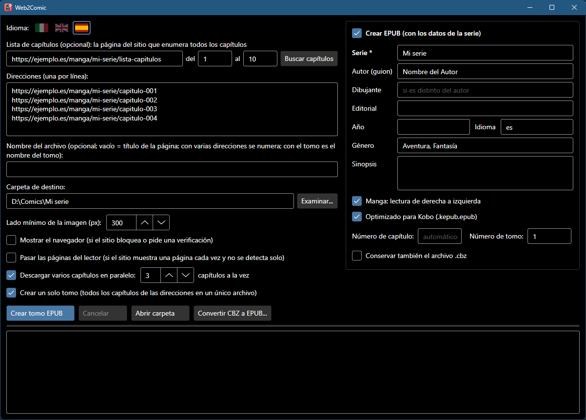

  <a href="README.md">🇬🇧 English</a> &nbsp;·&nbsp; <a href="README.it.md">🇮🇹 Italiano</a> &nbsp;·&nbsp; <b>🇪🇸 Español</b>

  

<h1 align="center">Web2Comic</h1>

  <b>De la página web a tu lector de libros electrónicos, en un clic.</b> 
  Pega la dirección de un capítulo: Web2Comic reúne las páginas y crea un cómic <code>.cbz</code> o un <code>EPUB</code> con título, serie y autor.

  
  
  
  

  <a href="https://github.com/nmorrione/Web2Comic/releases/latest/download/Web2Comic-Windows-x64.exe"><b>⬇ Descargar para Windows</b></a>
  &nbsp;·&nbsp;
  <a href="https://github.com/nmorrione/Web2Comic/releases/latest/download/Web2Comic-macOS-AppleSilicon.zip"><b>⬇ Descargar para Mac</b></a>

  

## Qué hace
- 📖 **Un capítulo entero en un archivo**: abre la página, la recorre hasta el final y reúne las imágenes en el orden correcto.
- 🔁 **También funciona con lectores de una página cada vez**: se da cuenta solo y pasa las páginas hasta la última.
- 📋 **Desde la lista de capítulos**: pega la página que enumera los capítulos de una serie, elige del/al y las direcciones se rellenan solas.
- 📦 **Varios capítulos seguidos**: una dirección por línea, un archivo por capítulo, o...
- 📕 **...un solo tomo**: todos los capítulos en un único archivo, con índice para saltar de un capítulo a otro.
- ⚡ **Varios capítulos en paralelo**: hasta 8 capítulos a la vez, aproximadamente el doble de rápido; si el sitio tiene un fallo momentáneo, el capítulo se reintenta solo.
- 📚 **EPUB con los datos de la serie**: título, serie, número de capítulo, autor y sinopsis aparecen en la biblioteca de tu lector. Con un clic, optimizado para **Kobo**.
- 🖼️ **Imágenes originales**: sin recompresión, la calidad es la misma que en el sitio.
- 🛡️ **Sin publicidad**: las ventanas emergentes y las pestañas nuevas se cierran, y la página no puede llevarte a otros sitios.
- 🌍 **En español, inglés e italiano**: arranca en el idioma del sistema y se cambia al momento con las banderas de arriba.
- 💼 **Portable**: un único archivo para ejecutar, sin instalación.

## Cómo se usa
1. Pega la dirección del capítulo (o varias direcciones, una por línea).
2. Elige la carpeta donde guardar.
3. Pulsa **Crear CBZ**. ¡Listo!

**¿Muchos capítulos?** Pega en **Lista de capítulos** la página del sitio que los enumera todos, indica **del** / **al** (vacíos = todos)
y pulsa **Buscar capítulos**: las direcciones pasan a **Direcciones**, donde puedes revisarlas antes de empezar.

**¿Un solo tomo?** Marca **Crear un solo tomo**: los capítulos se unen en un único archivo, llamado por ejemplo
"Mi serie - Capítulos 001-010" (o como escribas en **Nombre del archivo**). Si algún capítulo no se puede descargar,
la aplicación te avisa y te pregunta si quieres crear el tomo de todos modos con los demás.

**¿Un EPUB en lugar del CBZ?** Marca **Crear EPUB**, escribe el nombre de la serie (y si quieres autor, género, sinopsis...)
y copia los EPUB al lector por USB. Con el tomo también puedes indicar el **Número de tomo**: verás "Mi serie Vol. 01".
Si lees en un **Kobo**, marca también **Optimizado para Kobo**.

### ¿CBZ o EPUB? ¿Y para Kobo?
| Formato | Para quién |
|---|---|
| **CBZ** | El formato clásico de los cómics: lo leen Kobo, PocketBook y muchas aplicaciones para tableta y PC. Solo contiene las páginas, sin título ni autor. |
| **EPUB** | El estándar de todos los lectores de libros electrónicos (Kobo, PocketBook, Tolino, Apple Books, aplicaciones Android...), con título, serie, autor, sinopsis e índice. |
| **EPUB + Optimizado para Kobo** | El mismo EPUB, pero con el nombre `.kepub.epub`: así el Kobo lo abre con **su propio** lector, que muestra las páginas de los cómics a pantalla completa y pasa de página más rápido. Los demás lectores no lo reconocen. |

**¿Tienes un Kindle?** Los Kindle no leen ni CBZ ni EPUB de maquetación fija. Lo más sencillo es pasar los `.cbz` creados por Web2Comic a
[Kindle Comic Converter](https://github.com/ciromattia/kcc), un programa gratuito pensado para los cómics en Kindle.

### Qué marcar
Normalmente **nada**: Web2Comic entiende solo si la página muestra el capítulo entero o es un lector que hay que ir pasando.

| Casilla | Cuándo hace falta |
|---|---|
| **Mostrar el navegador** | El sitio tiene una protección anti-bots. La aplicación te avisa y la marca por ti: pulsa de nuevo el botón y, si aparece una verificación en la ventana, complétala tú. |
| **Pasar las páginas del lector** | Es un lector de una página cada vez, pero solo te llegó la primera página. |
| **Crear EPUB** | Quieres EPUB con los datos de la serie en lugar del simple `.cbz`. |
| **Optimizado para Kobo** | Lees los EPUB en un Kobo. |
| **Crear un solo tomo** | Quieres todos los capítulos en un único archivo en lugar de uno por capítulo. |
| **Descargar varios capítulos en paralelo** | Descargas muchos capítulos y quieres terminar antes (3 a la vez es un buen valor; si el sitio empieza a dar errores, bájalo). |

¿Ya tienes una carpeta llena de `.cbz`? El botón **Convertir CBZ a EPUB...** los convierte todos de una vez, sin descargar nada, con una tabla para corregir números y títulos de los capítulos.

## Instalación
**Windows 10/11**: descarga `Web2Comic-Windows-x64.exe` y ejecútalo. Usa Microsoft Edge, que ya viene con Windows.
Si aparece "Windows protegió su PC", haz clic en **Más información → Ejecutar de todas formas**: la aplicación no está firmada con un certificado de pago.

**Mac (Apple Silicon)**: descarga el zip, descomprímelo y mueve `Web2Comic.app` a **Aplicaciones**.
La primera vez macOS la bloquea porque no está firmada por Apple: ve a **Ajustes del Sistema → Privacidad y seguridad → Abrir igualmente**.
En la primera conversión descarga WebKit, el motor de Safari (solo una vez).

## Preguntas frecuentes

<b>Mi Kobo muestra "Autor desconocido" y el nombre del archivo</b>

Es normal con los `.cbz`: el software del Kobo no lee los datos que contienen. Usa **Crear EPUB** con **Optimizado para Kobo** y verás título, autor y portada.
La pestaña **Series** del Kobo, para libros copiados por USB, necesita el mod gratuito [NickelSeries](https://pgaskin.net/kepubify/ns/).

<b>En mi Kobo las páginas del cómic no se ven a pantalla completa</b>

Probablemente el EPUB se creó sin **Optimizado para Kobo**: con la extensión `.epub` el Kobo usa su lector más antiguo,
que maneja mal las páginas de tamaño fijo. Vuelve a crearlo con la casilla marcada (también a partir de los `.cbz`, con **Convertir CBZ a EPUB...**).

<b>Solo me llegó la primera página</b>

El sitio usa un lector que Web2Comic no reconoció: marca **Pasar las páginas del lector** y vuelve a intentarlo.
Si sigue sin funcionar, [abre una incidencia](https://github.com/nmorrione/Web2Comic/issues) con la dirección del sitio.

<b>En el archivo acaban logotipos o banners</b>

Sube **Lado mínimo de la imagen**: las imágenes más pequeñas que ese valor se descartan. Si en cambio faltan páginas, bájalo.

<b>¿Es gratis?</b>

Sí, y es de código abierto con licencia MIT. Úsalo solo para contenido que tengas derecho a descargar.

---

  ¿Eres desarrollador? Cómo compilarlo y cómo funciona está en <a href="docs/SVILUPPO.md">docs/SVILUPPO.md</a> (en italiano) · Licencia <a href="LICENSE">MIT</a>

