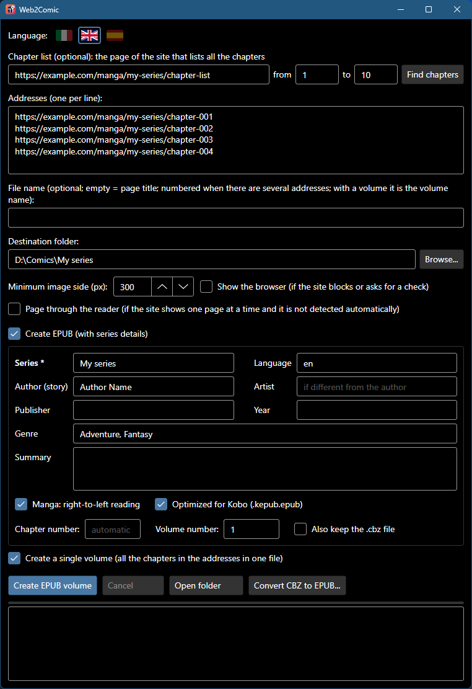

  <b>🇬🇧 English</b> &nbsp;·&nbsp; <a href="README.it.md">🇮🇹 Italiano</a> &nbsp;·&nbsp; <a href="README.es.md">🇪🇸 Español</a>

  

<h1 align="center">Web2Comic</h1>

  <b>From the web page to your ebook reader, in one click.</b> 
  Paste the address of a chapter: Web2Comic collects the pages and creates a <code>.cbz</code> comic or an <code>EPUB</code> with title, series and author.

  
  
  
  

  <a href="https://github.com/nmorrione/Web2Comic/releases/latest/download/Web2Comic-Windows-x64.exe"><b>⬇ Download for Windows</b></a>
  &nbsp;·&nbsp;
  <a href="https://github.com/nmorrione/Web2Comic/releases/latest/download/Web2Comic-macOS-AppleSilicon.zip"><b>⬇ Download for Mac</b></a>

  

## What it does
- 📖 **A whole chapter in one file**: opens the page, scrolls to the bottom and collects the images in the right order.
- 🔁 **Works with page-by-page readers too**: it notices on its own and pages through them to the last page.
- 📋 **From the chapter list**: paste the page that lists a series' chapters, choose from/to and the addresses fill themselves in.
- 📦 **Several chapters in a row**: one address per line, one file per chapter, or...
- 📕 **...a single volume**: all the chapters in one file, with a table of contents to jump between chapters.
- ⚡ **Several chapters in parallel**: up to 6 chapters at once, about twice as fast; if the site has a momentary hiccup, the chapter is retried automatically.
- 📚 **EPUB with series details**: title, series, chapter number, author and summary show up in your ebook reader's library. One click makes it **Kobo**-optimized.
- 🖼️ **Original images**: no recompression, the quality stays the same as on the site.
- 🛡️ **No ads**: pop-ups and new tabs are closed, and the page can't be taken to other sites.
- 🌍 **In English, Italian and Spanish**: starts in your system language and switches on the fly with the flags at the top.
- 💼 **Portable**: a single file to run, nothing to install.

## How to use it
1. Paste the chapter address (or several addresses, one per line).
2. Choose the folder to save to.
3. Press **Create CBZ**. Done!

**Lots of chapters?** Paste into **Chapter list** the page of the site that lists them all, set **from** / **to** (empty = all)
and press **Find chapters**: the addresses go into **Addresses**, where you can check them before starting.

**A single volume?** Tick **Create a single volume**: the chapters are merged into one file, named for example
"My series - Chapters 001-010" (or whatever you write in **File name**). If some chapters can't be downloaded,
the app tells you and asks whether to create the volume anyway with the others.

**An EPUB instead of a CBZ?** Tick **Create EPUB**, write the series name (and optionally author, genre, summary...)
and copy the EPUBs to your ebook reader via USB. With a volume you can also set the **Volume number**: you'll see "My series Vol. 01".
If you read on a **Kobo**, also tick **Optimized for Kobo**.

### CBZ or EPUB? And for Kobo?
| Format | Who it's for |
|---|---|
| **CBZ** | The classic comic format: read by Kobo, PocketBook and many tablet and PC apps. It only contains the pages, without title and author. |
| **EPUB** | The standard for every ebook reader (Kobo, PocketBook, Tolino, Apple Books, Android apps...), with title, series, author, summary and table of contents. |
| **EPUB + Optimized for Kobo** | The same EPUB, but named `.kepub.epub`: this way the Kobo opens it with **its own** reader, which shows comic pages full screen and turns pages faster. Other ebook readers don't recognize it. |

**Got a Kindle?** Kindles read neither CBZ nor fixed-layout EPUB. The easiest way is to give the `.cbz` files created by Web2Comic to
[Kindle Comic Converter](https://github.com/ciromattia/kcc), a free program made for comics on Kindle.

### What to tick
Usually **nothing**: Web2Comic works out on its own whether the page shows the whole chapter or is a reader to page through.

| Checkbox | When you need it |
|---|---|
| **Show the browser** | The site has anti-bot protection. The app tells you and ticks it for you: press the button again and, if a check appears in the window, complete it yourself. |
| **Page through the reader** | It's a page-by-page reader, but you only got the first page. |
| **Create EPUB** | You want EPUBs with series details instead of plain `.cbz` files. |
| **Optimized for Kobo** | You read the EPUBs on a Kobo. |
| **Create a single volume** | You want all the chapters in one file instead of one per chapter. |
| **Download several chapters in parallel** | You're downloading many chapters and want it faster (3 at a time is a good value; if the site starts giving errors, lower it). |

Already have a folder full of `.cbz` files? The **Convert CBZ to EPUB...** button converts them all at once, without downloading anything, with a table to fix chapter numbers and titles.

## Installation
**Windows 10/11**: download `Web2Comic-Windows-x64.exe` and run it. It uses Microsoft Edge, already included in Windows.
If "Windows protected your PC" appears, click **More info → Run anyway**: the app isn't signed with a paid certificate.

**Mac (Apple Silicon)**: download the zip, extract it and move `Web2Comic.app` to **Applications**.
On first launch macOS blocks it because it isn't signed by Apple: go to **System Settings → Privacy & Security → Open Anyway**.
On the first conversion it downloads WebKit, Safari's engine (only once).

## FAQ

<b>My Kobo shows "Unknown author" and the file name</b>

That's normal with `.cbz` files: the Kobo software doesn't read the data inside them. Use **Create EPUB** with **Optimized for Kobo** and you'll see title, author and cover.
The Kobo **Series** tab, for books copied via USB, requires the free [NickelSeries](https://pgaskin.net/kepubify/ns/) mod.

<b>On my Kobo the comic pages aren't full screen</b>

The EPUB was probably created without **Optimized for Kobo**: with the `.epub` extension the Kobo uses its older reader,
which handles fixed-size pages poorly. Create it again with the box ticked (also from the `.cbz` files, with **Convert CBZ to EPUB...**).

<b>I only got the first page</b>

The site uses a reader that Web2Comic didn't recognize: tick **Page through the reader** and try again.
If it still doesn't work, [open an issue](https://github.com/nmorrione/Web2Comic/issues) with the site's address.

<b>Logos or banners end up in the file</b>

Raise **Minimum image side**: images smaller than that value are discarded. If pages are missing instead, lower it.

<b>Is it free?</b>

Yes, and it's open source under the MIT license. Only use it for content you have the right to download.

---

  Developer? Building and internals are described in <a href="docs/SVILUPPO.md">docs/SVILUPPO.md</a> (Italian) · <a href="LICENSE">MIT</a> license

