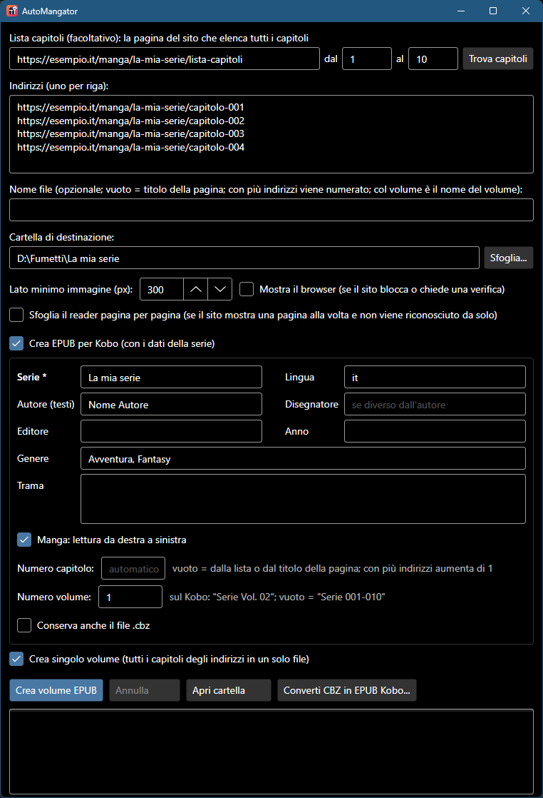

  

<h1 align="center">AutoMangator</h1>

  <b>Dalla pagina web al tuo ebook reader, in un clic.</b> 
  Incolla l'indirizzo di un capitolo: AutoMangator raccoglie le pagine e crea un fumetto <code>.cbz</code> o un <code>EPUB</code> pronto per Kobo.

  
  
  
  

  <a href="https://github.com/nmorrione/AutoMangator/releases/latest/download/AutoMangator-Windows-x64.exe"><b>⬇ Scarica per Windows</b></a>
  &nbsp;·&nbsp;
  <a href="https://github.com/nmorrione/AutoMangator/releases/latest/download/AutoMangator-macOS-AppleSilicon.zip"><b>⬇ Scarica per Mac</b></a>

  

## Cosa fa
- 📖 **Capitolo intero in un file**: apre la pagina, la scorre fino in fondo e raccoglie le immagini nell'ordine giusto.
- 🔁 **Funziona anche con i reader a una pagina per volta**: se ne accorge da solo e li sfoglia fino all'ultima pagina.
- 📋 **Dalla lista dei capitoli**: incolla la pagina che elenca i capitoli di una serie, scegli dal/al e gli indirizzi si compilano da soli.
- 📦 **Più capitoli in coda**: un indirizzo per riga, un file per capitolo, oppure...
- 📕 **...un unico volume**: tutti i capitoli in un solo file, con l'indice per saltare da un capitolo all'altro.
- 📚 **EPUB per Kobo**: titolo, serie, numero del capitolo, autore e trama compaiono nella libreria del Kobo.
- 🖼️ **Immagini originali**: nessuna ricompressione, la qualità resta quella del sito.
- 🛡️ **Niente pubblicità**: popup e nuove schede vengono chiusi, e la pagina non può essere portata su altri siti.
- 💼 **Portable**: un unico file da avviare, niente installazione.

## Come si usa
1. Incolla l'indirizzo del capitolo (o più indirizzi, uno per riga).
2. Scegli la cartella dove salvare.
3. Premi **Crea CBZ**. Fatto!

**Tanti capitoli?** Incolla in **Lista capitoli** la pagina del sito che li elenca tutti, indica **dal** / **al** (vuoti = tutti)
e premi **Trova capitoli**: gli indirizzi finiscono in **Indirizzi**, dove puoi controllarli prima di partire.

**Un volume unico?** Spunta **Crea singolo volume**: i capitoli vengono uniti in un solo file, chiamato per esempio
"La mia serie - Capitoli 001-010" (oppure come scrivi in **Nome file**). Se qualche capitolo non si riesce a scaricare,
l'app te lo dice e ti chiede se creare comunque il volume con gli altri.

Vuoi leggerlo sul **Kobo**? Spunta **Crea EPUB per Kobo**, scrivi il nome della serie (ed eventualmente autore, genere, trama...)
e copia gli EPUB nel Kobo via USB. Con il volume puoi indicare anche il **Numero volume**: sul Kobo vedrai "La mia serie Vol. 01".

### Cosa spuntare
Di solito **niente**: AutoMangator capisce da solo se la pagina mostra tutto il capitolo o è un reader da sfogliare.

| Casella | Quando serve |
|---|---|
| **Mostra il browser** | Il sito ha una protezione anti-bot. Te lo dice l'app e spunta la casella per te: premi di nuovo il pulsante e, se nella finestra compare una verifica, completala tu. |
| **Sfoglia il reader pagina per pagina** | È un reader a una pagina per volta, ma ti è arrivata solo la prima pagina. |
| **Crea EPUB per Kobo** | Vuoi gli EPUB con i dati della serie invece del semplice `.cbz`. |
| **Crea singolo volume** | Vuoi tutti i capitoli in un unico file invece di uno per capitolo. |

Hai già una cartella piena di `.cbz`? Il pulsante **Converti CBZ in EPUB Kobo...** li trasforma tutti in una volta, senza scaricare nulla, con una tabella per correggere numeri e titoli dei capitoli.

## Installazione
**Windows 10/11**: scarica `AutoMangator-Windows-x64.exe` e avvialo. Usa Microsoft Edge, già presente in Windows.
Se compare "Windows ha protetto il PC", clicca **Ulteriori informazioni → Esegui comunque**: l'app non è firmata con un certificato a pagamento.

**Mac (Apple Silicon)**: scarica lo zip, estrailo e sposta `AutoMangator.app` in **Applicazioni**.
Al primo avvio macOS la blocca perché non è firmata da Apple: vai in **Impostazioni di Sistema → Privacy e sicurezza → Apri comunque**.
Alla prima conversione scarica WebKit, il motore di Safari (una volta sola).

## Domande frequenti

<b>Il Kobo mostra "Autore sconosciuto" e il nome del file</b>

È normale con i `.cbz`: il software del Kobo non legge i dati al loro interno. Usa **Crea EPUB per Kobo** e vedrai titolo, autore e copertina.
La scheda **Serie** del Kobo, per i libri copiati via USB, richiede la mod gratuita [NickelSeries](https://pgaskin.net/kepubify/ns/).

<b>Mi è arrivata solo la prima pagina</b>

Il sito usa un reader che AutoMangator non ha riconosciuto: spunta **Sfoglia il reader pagina per pagina** e riprova.
Se ancora non funziona, [apri una segnalazione](https://github.com/nmorrione/AutoMangator/issues) con l'indirizzo del sito.

<b>Nel file finiscono loghi o banner</b>

Alza **Lato minimo immagine**: le immagini più piccole di quel valore vengono scartate. Se invece mancano pagine, abbassalo.

<b>È gratis?</b>

Sì, ed è open source con licenza MIT. Usalo solo per contenuti che hai il diritto di scaricare.

---

  Sei uno sviluppatore? Trovi come compilarlo e come funziona in <a href="docs/SVILUPPO.md">docs/SVILUPPO.md</a> · Licenza <a href="LICENSE">MIT</a>

